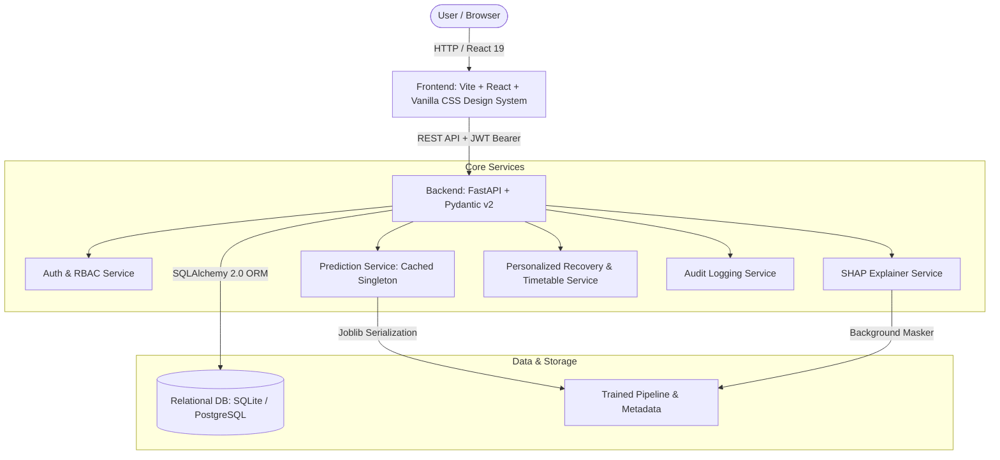
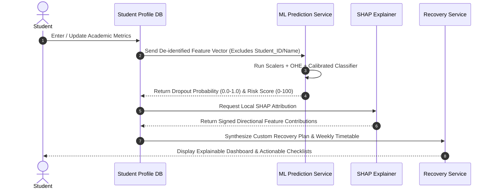

# System Architecture & Technical Specifications

## 1. High-Level Architecture Overview

The **Student Success Early-Warning System** is an explainable machine-learning web application built to identify undergraduate students at risk of discontinuation early in the academic semester and formulate non-punitive, personalized academic recovery roadmaps.

---

## 2. Privacy & Identity Isolation Design

To prevent algorithmic bias, institutional stereotyping, and privacy leakage:
1. **Separation of PII from Features:**
   - Personal identifiable information (`full_name`, `email`, institutional identifier `student_institutional_id`) is stored strictly in `users` and `student_profiles` tables.
   - When calling ML inference, the backend constructs an ephemeral, anonymous vector containing only validated behavioral and academic attributes (`GPA`, `Attendance_Rate`, `Study_Hours_per_Day`, etc.).
   - `Student_ID` is strictly excluded from training, validation, and inference features.

---

## 3. Role-Based Access Control (RBAC) Matrix

| Endpoint Group | Student | Faculty Advisor | Management Reviewer | Administrator |
|---|---|---|---|---|
| `GET /profiles/me` | Own profile only | N/A | N/A | Own profile |
| `PUT /profiles/me` | Own profile only | N/A | N/A | Own profile |
| `GET /profiles/{id}` | Forbidden if `id != own` | Permitted **only for assigned cohort** | **Forbidden** (De-identified only) | Full Access |
| `GET /predictions/latest` | Own prediction | Forbidden | Forbidden | Forbidden |
| `GET /predictions/student/{id}` | Forbidden if `id != own` | Permitted for assigned cohort | **Forbidden** | Full Access |
| `GET /recovery/current` | Own active plan | Forbidden | Forbidden | Forbidden |
| `PUT /recovery/tasks/{id}/toggle` | Own plan tasks | Assigned cohort | Forbidden | Full Access |
| `GET /advisor/assigned-students` | Forbidden | **Assigned cohort only** | Forbidden | All students |
| `POST /advisor/interventions` | Request meeting | Schedule & record follow-up | Forbidden | Full Access |
| `GET /analytics/overview` | Forbidden | Department aggregate | **Full de-identified aggregate** | Full Access |
| `GET /admin/*` | Forbidden | Forbidden | Forbidden | **Full Access** |
| `POST /admin/retrain` | Forbidden | Forbidden | Forbidden | **Full Access** |

---

## 4. Machine Learning & Calibration Architecture

1. **Preprocessing Pipeline (`ColumnTransformer`):**
   - **Numerical:** `SimpleImputer(strategy='median')` followed by `StandardScaler()`.
   - **Categorical:** `SimpleImputer(strategy='constant', fill_value='Missing')` followed by `OneHotEncoder(handle_unknown='ignore', sparse_output=False)`.
2. **Model Benchmark & Selection:**
   - Compares **Logistic Regression (Class-Weighted)**, **Random Forest (Balanced Subsample)**, and **XGBoost (Scale Pos Weight)**.
   - Evaluated on a 70% Train / 15% Validation / 15% Held-out Test stratified split.
   - Optimized for identifying at-risk students (Recall) without excessive false alarms (Precision), prioritizing PR-AUC and F1-score.
3. **Probability Calibration:**
   - Uses `CalibratedClassifierCV(method='sigmoid', cv=3)` (Platt Scaling) to ensure estimated probabilities reflect true empirical frequencies.
4. **Explainability (`SHAP`):**
   - Computes local Shapley values comparing the student's attribute states against a representative training background.
   - Translates positive contributions to "increases estimated risk" and negative contributions to "reduces estimated risk".
